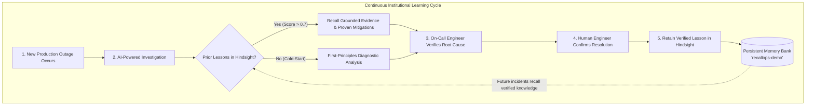

# RecallOps 🛡️

> **An AI Incident Response Agent That Learns From Every Failure.**

RecallOps is an AI-powered incident investigation and response assistant engineered for Site Reliability Engineering (SRE) and DevOps teams. Unlike typical stateless LLM wrappers that treat every infrastructure outage like day one, RecallOps leverages **Hindsight persistent memory** (`@vectorize-io/hindsight-client`) to recall verified historical incident resolutions, compare active symptoms, generate evidence-backed root-cause hypotheses, and retain confirmed post-mortems so engineering teams never debug the same outage twice.

---

## 🎯 The Problem

When production systems break at 3 AM:
1. **Stateless AI Amnesia**: Generic chatbots and LLM assistants lack memory of your architecture's unique quirks, failure modes, and past post-mortems. Every incident starts from zero context.
2. **Tribal Knowledge Loss**: Senior engineers solve an esoteric connection pool starvation or token race condition. Three months later, a different on-call engineer spends 4 agonizing hours rediscovering the exact same root cause.
3. **Hallucination Risk**: Standard AI models frequently suggest speculative or inaccurate commands without grounding in verified institutional ground truths.
4. **Dangerous Autonomous Remediation**: Untested bots executing autonomous remediation commands in production risk triggering cascading failures and data loss.

---

## 💡 The Solution: Continuous Institutional Learning

RecallOps implements a closed-loop incident intelligence workflow powered by **Hindsight persistent memory**:



### How RecallOps Learns Across Multiple Interactions

1. **Incident 1 (Cold-Start)**: A payment gateway fails under traffic spikes (`HTTP 504`, out-of-memory heap exhaustion). RecallOps investigates with no prior memories, providing a structured first-principles analysis.
2. **Human Confirmation**: The on-call engineer fixes the issue by increasing the Node.js memory ceiling (`--max-old-space-size=4096`) and capping the connection pool. The engineer confirms the resolution in RecallOps.
3. **Retention**: Only upon this human confirmation does RecallOps execute `client.retain()` into Hindsight, where facts, entities, and symptoms are extracted and persisted in the `recallops-demo` memory bank.
4. **Incident 2 (Memory-Informed)**: Weeks later, the order microservice experiences similar heap exhaustion. RecallOps automatically queries Hindsight via `client.recall()`.
5. **Instant Evidence-Backed Resolution**: RecallOps retrieves the exact lesson from Incident 1 with a high similarity score, presents the verified fix, and guides the engineer to the proven mitigation within seconds.

---

## 🏗️ Architecture & Storage Tier Separation

RecallOps enforces a strict, decoupled boundary between relational application state, persistent memory, and LLM inference:

```mermaid
flowchart TD
    subgraph Client["Frontend Tier (React + Vite + Tailwind CSS)"]
        Dashboard["Command Center Dashboard"]
        Investigate["AI Investigation Workspace"]
        MemExplorer["Hindsight Memory Explorer"]
        ConfirmModal["Human Resolution Confirmation"]
    end

    subgraph Backend["Backend API Tier (Node.js + Express + TypeScript)"]
        Router["REST Endpoints (/api/*) & Zod Validation"]
        IncidentsCtrl["Incident & Investigation Controller"]
        MemoriesCtrl["Hindsight Memory Controller"]
    end

    subgraph AppState["Relational Application State"]
        SQLite[("SQLite (dev.db via Prisma ORM)\n- Incidents & Metadata\n- Audit Trail & Activity Logs\n- Resolution Records")]
    end

    subgraph MemoryTier["Persistent Memory Substrate"]
        Hindsight[("Hindsight Engine (@vectorize-io/hindsight-client)\n- Bank ID: recallops-demo\n- 4-Way Parallel Retrieval (Semantic, BM25, Graph, Temporal)\n- Asynchronous Fact Extraction Worker\n- Persistent Volume: hindsight-data")]
    end

    subgraph Inference["LLM Reasoning Layer"]
        Groq["Groq API (llama-3.3-70b-versatile)\n- Structured JSON Schema Enforcement\n- Strict Fact / Observation / Hypothesis Separation"]
    end

    Client <-->|REST API / JSON| Backend
    Backend <-->|Prisma ORM| SQLite
    Backend <-->|retain(), recall(), reflect()| Hindsight
    Backend <-->|Structured Prompts| Groq
```

### Explicit Responsibilities of Each Tier

| Tier | Technology | Purpose & Stored Data |
|---|---|---|
| **Relational Application State** | **SQLite** (`dev.db` via Prisma ORM) | Stores standard application records: incident ticket statuses, service names, timestamps, audit trails, and user activity history. |
| **Persistent Memory Substrate** | **Hindsight** (`recallops-demo` bank) | Authoritative persistent memory layer. Extracts entities, temporal relationships, knowledge graph linkages, and semantic vectors from confirmed lessons. Provides 4-way parallel recall (semantic, keyword BM25, knowledge graph traversal, and temporal decay) and pattern reflection. |
| **LLM Reasoning Layer** | **Groq** (`llama-3.3-70b-versatile`) | Fast, structured inference. Synthesizes recalled historical evidence with live incident telemetry to output structured hypotheses, recommended commands, and risk assessments. |

---

## 🛡️ Hindsight Integration & Human-in-the-Loop Safety Model

### 1. Official SDK Usage
RecallOps connects to Hindsight using the official `@vectorize-io/hindsight-client` TypeScript package:
- `client.recall(bankId, query)`: Real-time 4-way parallel memory recall triggered at investigation time.
- `client.retain(bankId, content, options)`: Ingests confirmed incident lessons into the memory bank.
- `client.reflect(bankId, query)`: Synthesizes high-level cross-incident pattern recognition when multiple related outages exist.

### 2. Human-in-the-Loop Confirmation Gate
To prevent memory pollution, **unconfirmed incidents and AI hypotheses are NEVER retained in Hindsight**. 
- Opening a new incident ticket creates an unverified record in SQLite only.
- AI investigation is strictly a read-only memory retrieval operation.
- Retention is executed **only** after an engineer reviews the investigation, inputs the verified actual cause and fix, and clicks **"Confirm Resolution & Retain Lesson"**.

### 3. Asynchronous Extraction & Persistence Verification
When Hindsight ingests a lesson, background workers extract facts, graph links, and vector embeddings. RecallOps tracks operation IDs and queries the Hindsight bank to verify that memories are actively persisted in the persistent Docker volume before reporting successful persistence.

---

## ⚙️ Quickstart & Local Setup

### Prerequisites
- **Node.js**: 20+ (Node.js 22+ recommended)
- **Docker**: Docker Desktop (for local Hindsight container)
- **Groq API Key**: Standard API key from [Groq Console](https://console.groq.com)

---

### Step 1: Start Hindsight Local Memory Engine

Run the official Hindsight container with persistent volume storage and the Groq `service_tier=on_demand` configuration:

#### Option A: Docker Run
```bash
docker run -d \
  --name hindsight \
  -p 8888:8888 \
  -p 9999:9999 \
  -v hindsight-data:/home/hindsight/.pg0 \
  -e HINDSIGHT_API_WORKER_ID=hindsight-local \
  -e HINDSIGHT_API_LLM_PROVIDER=groq \
  -e HINDSIGHT_API_LLM_API_KEY="your-groq-api-key" \
  -e HINDSIGHT_API_LLM_MODEL="openai/gpt-oss-20b" \
  -e HINDSIGHT_API_LLM_GROQ_SERVICE_TIER="on_demand" \
  -e HINDSIGHT_API_HOST=0.0.0.0 \
  -e HINDSIGHT_API_PORT=8888 \
  -e HINDSIGHT_CP_DATAPLANE_API_URL=http://localhost:8888 \
  -e HINDSIGHT_ENABLE_API=true \
  -e HINDSIGHT_ENABLE_CP=true \
  ghcr.io/vectorize-io/hindsight:latest
```

#### Option B: Docker Compose
Create a `.env` in the root containing your `GROQ_API_KEY`, then run:
```bash
docker compose up -d
```

> **Why `HINDSIGHT_API_LLM_GROQ_SERVICE_TIER=on_demand`?**  
> Standard Groq accounts do not have access to the Groq `auto` service tier. Specifying `on_demand` ensures Hindsight's background extraction worker successfully calls Groq without HTTP 400 rejection errors.

- **Hindsight API**: `http://localhost:8888`
- **Hindsight Dashboard**: `http://localhost:9999`
- **Health Check**: `http://localhost:8888/health`

---

### Step 2: Configure Environment Variables

**Backend (`backend/.env`):**
```env
PORT=5000
NODE_ENV=development
FRONTEND_URL=http://localhost:5173
DATABASE_URL="file:./dev.db"

# Hindsight Local Engine
HINDSIGHT_BASE_URL=http://localhost:8888
HINDSIGHT_API_KEY=
HINDSIGHT_BANK_ID=recallops-demo

# Groq LLM Inference
GROQ_API_KEY="your-groq-api-key"
GROQ_MODEL=llama-3.3-70b-versatile
```

**Frontend (`frontend/.env`):**
```env
VITE_API_BASE_URL=http://localhost:5000/api
```

---

### Step 3: Install Dependencies & Initialize Database

```bash
# Install root, backend, and frontend dependencies
npm install
npm --prefix backend install
npm --prefix frontend install

# Initialize local SQLite database schema & seed demonstration incidents
npm --prefix backend run db:push
npm --prefix backend run db:seed
```

---

### Step 4: Run RecallOps

**Terminal 1 — Backend:**
```bash
npm --prefix backend run dev
# Backend running on http://localhost:5000
```

**Terminal 2 — Frontend:**
```bash
npm --prefix frontend run dev
# Frontend running on http://localhost:5173
```

Open `http://localhost:5173` in your browser.

---

## 🧪 Automated Test Suite

RecallOps includes 21 comprehensive automated tests across unit validation, business safety rules, and live end-to-end Hindsight memory persistence:

```bash
# Run full Vitest test suite
npm test
```

### Test Coverage Highlights:
- **`incident.test.ts` (19 tests)**: Zod validation schemas, cold-start investigation fallbacks, credential masking, human confirmation enforcement, and refusal to retain unverified lessons.
- **`hindsight-e2e.test.ts` (2 tests)**: Real Docker integration tests that verify Hindsight health endpoints, asynchronously retain a synthetic incident lesson, poll for extraction completion, and perform semantic recall queries.

---

## 🌐 Production & Vercel Deployment

### Frontend Showcase Deployment
The frontend is deployed to Vercel as a production single-page application (SPA):
- **Live Vercel URL**: Accessible via your Vercel project deployment link.
- **Routing Configuration**: `frontend/vercel.json` provides rewrite rules ensuring client-side React routes (`/investigate`, `/memories`, `/incidents`) resolve seamlessly.

### Full-Stack Production Architecture
- **Frontend**: Hosted on Vercel Edge Network.
- **Backend API**: Can be hosted on Railway, Render, Fly.io, or AWS ECS with environment variables pointing to a managed database and cloud Hindsight instance.
- **Hindsight Memory Substrate**: Connects to [Hindsight Cloud](https://hindsight.vectorize.io) by providing `HINDSIGHT_BASE_URL=https://api.hindsight.vectorize.io` and `HINDSIGHT_API_KEY=your_key`.
- When accessing the Vercel frontend without a deployed production backend, the application displays clear connection notices rather than falling back to localhost or simulating fake memories.

---

## ⚠️ Known Limitations & Honest Trade-offs

1. **Groq Free-Tier Rate Limits (8,000 TPM)**:  
   Standard free-tier Groq API accounts have a rate limit of 8,000 Tokens Per Minute. Consecutive rapid calls (such as retention fact extraction followed immediately by multi-document reflection) can temporarily hit HTTP 429 limits. RecallOps and Hindsight handle this through exponential backoff circuit breakers and surface clear rate-limit notices to the user rather than failing silently.
2. **Read-Only Automated Guidance**:  
   RecallOps generates safe, verified remediation commands, but deliberately requires an engineer to copy and execute them. It does not possess direct SSH or Kubernetes write access to production clusters.
3. **Local Docker Container Requirement for Free Tier**:  
   When running with local Hindsight, Docker Desktop must be running locally on ports 8888 and 9999.

---

## 🗺️ Future Roadmap

- [ ] **Bi-directional PagerDuty / Opsgenie Webhooks**: Automatically trigger investigations when alerts fire.
- [ ] **Slack & Microsoft Teams Incident Bot**: Conduct interactive investigations and confirm resolutions directly within dedicated incident war-room channels.
- [ ] **Automated Post-Mortem Markdown Generation**: Export Hindsight-backed post-mortem incident reports directly to GitHub Discussions or Confluence.
- [ ] **Automated Drift Detection**: Alert engineers when new deployment runbooks conflict with past retained incident resolutions.

---

## 📄 License
MIT License. Built with ❤️ for the Vectorize Hindsight Hackathon.
