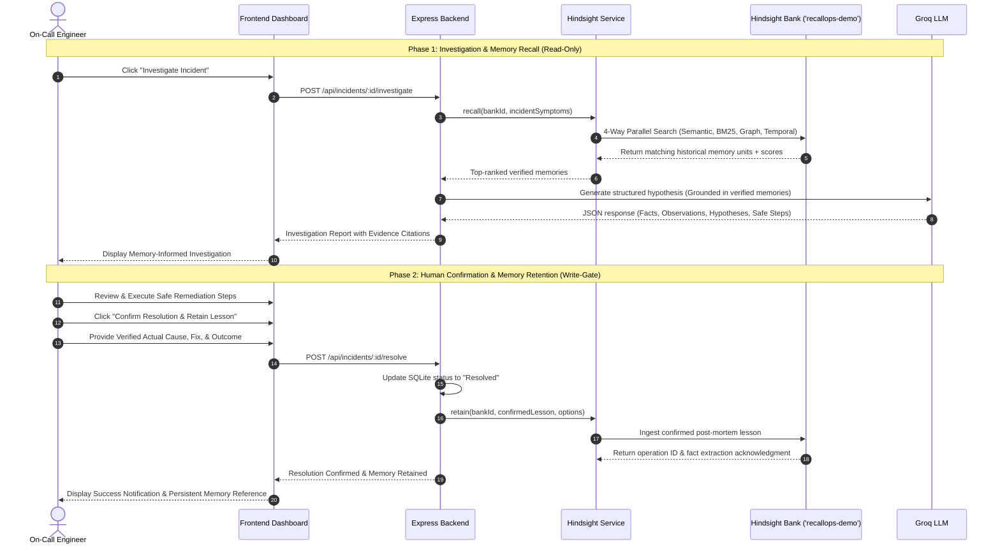

# RecallOps — System Architecture & Design Specification

> **An AI Incident Response Agent That Learns From Every Failure.**

---

## 1. Architectural Philosophy

Engineering incident response is fundamentally an **institutional memory problem**.

Traditional incident response workflows suffer from severe organizational amnesia: post-mortems live in disconnected wikis, Slack discussions vanish into archives, and on-call engineers are forced to reinvent diagnostic wheels during high-pressure outages.

RecallOps closes this operational loop by introducing **Hindsight persistent memory** as the core intelligence substrate for incident triage, hypothesis generation, and post-mortem retention.

---

## 2. System Architecture Diagram

```mermaid
flowchart TD
    subgraph ClientTier["Client Tier (Frontend)"]
        Dashboard["Dashboard View\n(KPIs, Memory State, Recent Incidents)"]
        IncidentList["Incident Command Center\n(Triage, Status Filters, Severity Badges)"]
        InvestigationWorkspace["AI Investigation Workspace\n(Cold-Start vs Memory-Informed Analysis)"]
        MemoryExplorer["Hindsight Memory Explorer\n(Interactive Recall Inspector & Operation Log)"]
        ResolutionModal["Human Confirmation Modal\n(Verified Fix & Root Cause Input)"]
    end

    subgraph APITier["Application Backend (Node.js + Express + TypeScript)"]
        Router["REST Router & Zod Request Validation"]
        IncidentService["Incident Management Service"]
        HindsightService["Hindsight Memory Service\n(@vectorize-io/hindsight-client)"]
        GroqService["Groq AI Inference Service\n(llama-3.3-70b-versatile)"]
        AuditLogger["Winston Structured Audit Logger"]
    end

    subgraph DataTier["Data & State Persistence"]
        SQLite[("Relational Database\nSQLite (dev.db via Prisma ORM)\n- Incidents\n- Investigations\n- Resolutions\n- Activity Audit Trail")]
        
        HindsightEngine[("Hindsight Persistent Memory Substrate\nMemory Bank: 'recallops-demo'\n- 4-Way Parallel Recall Engine\n- Knowledge Graph Relationships\n- Temporal Proximity & Decay\n- Async Fact Extraction Worker\n- Persistent Volume: hindsight-data")]
    end

    %% Client to Backend
    Dashboard <-->|GET /api/incidents, /api/memories| Router
    IncidentList <-->|GET /api/incidents, POST /api/incidents| Router
    InvestigationWorkspace -->|POST /api/incidents/:id/investigate| Router
    ResolutionModal -->|POST /api/incidents/:id/resolve| Router
    MemoryExplorer <-->|GET /api/memories, POST /api/memories/recall| Router

    %% Backend internal orchestration
    Router --> IncidentService
    Router --> HindsightService
    Router --> AuditLogger

    IncidentService <-->|CRUD Operations| SQLite
    IncidentService -->|1. Request Historical Memories| HindsightService
    HindsightService <-->|recall(), retain(), reflect()| HindsightEngine
    
    IncidentService -->|2. Ingest Symptoms + Retrieved Memories| GroqService
    GroqService -->|3. Grounded Structured Hypothesis| IncidentService
```

---

## 3. Storage Tier Separation & Boundaries

RecallOps establishes explicit operational boundaries between its data tiers to avoid architectural conflation:

| Data Layer | Substrate | Primary Responsibilities | Data Retention Model |
|---|---|---|---|
| **Relational Application State** | **SQLite** (`dev.db` via Prisma ORM) | Tracks ticket state machines (`Open` -> `Investigating` -> `Resolved`), service catalogs, timestamps, investigator metadata, and structured audit event trails. | Relational rows with foreign key cascade relationships. |
| **Persistent Institutional Memory** | **Hindsight** (`recallops-demo` bank) | Indexes extracted facts, temporal links, entities, and semantic vectors from verified post-mortems. Powers 4-way parallel memory recall and multi-incident reflection. | Persistent graph and vector substrate stored in `hindsight-data` Docker volume. |
| **Transient AI Inference** | **Groq SDK** (`llama-3.3-70b-versatile`) | Stateless inference. Performs reasoning by combining active incident observations with retrieved Hindsight memory units under strict JSON schema enforcement. | Stateless; outputs are persisted into SQLite and displayed in the frontend. |

---

## 4. Hindsight Memory Integration Flow



---

## 5. Memory Bank Architecture (`recallops-demo`)

The `recallops-demo` bank is configured as an institutional incident repository:
- **Fact Extraction Pipeline**: Ingests structured post-mortem summaries, identifying affected components, root-cause mechanisms, mitigation procedures, and error signatures.
- **4-Way Parallel Recall**:
  1. *Semantic Vector Search*: Discovers conceptually related outages even when symptom wording differs (e.g., "memory leak" vs "heap space starvation").
  2. *Keyword BM25*: Matches precise technical terms, error codes (e.g., `ETIMEDOUT`, `OOMKilled`, `HTTP 504`), and service identifiers.
  3. *Knowledge Graph Linkages*: Traverses dependency connections between services, databases, and third-party APIs.
  4. *Temporal Proximity & Recency*: Weights lessons based on recency and relevance to modern architecture.
- **Reflection Engine**: Invokes `client.reflect()` across clusters of related incidents to discover cross-service trends (e.g., recurring connection pool exhaustion across multiple API gateways).

---

## 6. Security & Human-in-the-Loop Safety Model

1. **Zero Secret Exposure in Frontend**:  
   All credentials (`GROQ_API_KEY`, `HINDSIGHT_API_KEY`, `DATABASE_URL`) are strictly contained within server-side environment variables. The frontend interacts only with authenticated `/api/*` endpoints.
2. **Read-Only Memory Recall During Investigation**:  
   Investigating an incident never alters or pollutes the Hindsight memory bank. Investigation is an entirely read-only retrieval operation.
3. **Strict Human Confirmation Gate**:  
   Unverified AI diagnoses or unconfirmed tickets are strictly prevented from entering the Hindsight memory substrate. A lesson is indexed only when an authorized engineer explicitly inputs the confirmed root cause and resolution.
4. **Non-Autonomous Remediation Policy**:  
   RecallOps recommends diagnostic commands and verified remediation actions for human review and execution. It does not possess direct SSH, root, or Kubernetes cluster manipulation rights, eliminating the risk of automated cascading damage.
5. **Input Sanitation & Schema Enforcement**:  
   All incoming requests are strictly validated using Zod schemas (`backend/src/schemas/incident.ts`) to prevent prompt injection and malformed inputs.
